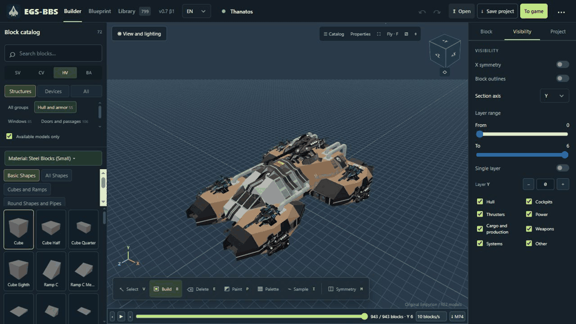

<h1 align="center">EGS-BBS</h1>

Empyrion Galactic Survival: Build &amp; Blueprint Ships

Windows x64 · Empyrion + Reforged Eden 2 · RU / EN

[Русский](README.ru.md) · [Download](https://github.com/Tefoke1/EGS-BBS/releases/tag/v0.7.0-beta.1) · [Release notes](CHANGELOG.md) · [Architecture & trust](docs/TRUST.md) · [Licenses](docs/DEPENDENCIES.md)

**Open a ship. Understand its structure. Make it yours.**

A local 3D blueprint editor using models, textures and colors from your installed game. Inspect Workshop subscriptions and your own blueprints, edit individual parts, look inside the hull and export a blueprint back to Empyrion.

## See inside your ship

Choose an axis and move the layer range. This hides blocks for inspection; it does not delete them. The GIF cycles between the complete ship and two half-sections.

| Half-section along X | Half-section along Z |
|---|---|
|  |  |

## What you can do

| Build & edit | Inspect & present |
|---|---|
| Game-derived shape catalog and material picker | X/Y/Z ranges, individual layers, device filters |
| Select, copy, paint, decals, 90° rotation, symmetry | Mass, power, CPU, component and Factory resource summaries |
| Undo/redo and local project backups | Bottom-to-top construction timeline, one block at a time |
| Workshop subscriptions and personal blueprint discovery | Fast / realistic / experimental cinematic rendering |
| Import EPB; export a new EPB into your personal game library | 4K PNG and MP4: manual camera, orbit or four-shot sequence |

### Photo & film

Original paint and decals stay on the ship. Adjust light, exposure, shadow fill and material wear. Cinematic processing includes HDR, reflections and accumulated antialiasing; it is **not ray-traced global illumination**, and does not remove the block silhouette.

Manual filming records camera movement first, then renders MP4 at fixed timestamps. Heavy scenes take longer to export instead of skipping output frames. The filming screenshot shows the Russian UI; the application also has English controls.

## Download and start

**[0.7.0-beta.1 · portable Windows x64 ZIP](https://github.com/Tefoke1/EGS-BBS/releases/tag/v0.7.0-beta.1)** — a prerelease, not a stable build.

1. Extract the **whole ZIP** into a writable folder. Keep the EXE and adjacent runtime files together.
2. Run `EGS-BBS.exe`; no separate Node.js or Python installation is needed.
3. Select your Steam / SteamLibrary folder. Empyrion and the downloaded RE2 subscription must already be installed.
4. Wait for the first local import. Progress and stage are shown; later launches reuse the cache.
5. Open a ship from **Library**, edit it and use **To game**. Follow the in-app Factory / Workshop checklist. Steam publishing is performed in the game, not silently by this tool.

Back up projects as `.ship.json` before updating. Local data is stored in `%APPDATA%/EGS-BBS`. Install updates into a new extracted folder. Original Workshop blueprints are preserved; game export creates a new personal blueprint folder.

## Hardware

These are practical recommendations, **not benchmark-validated minimum requirements**.

| Component | Recommendation |
|---|---|
| OS | Windows 11 x64 (tested); no macOS/Linux package |
| RAM | 16 GB for ordinary ships; 32 GB for very large projects and other open applications |
| GPU | Hardware WebGL 2; dedicated GPU with 8 GB VRAM recommended for large ships/photo mode |
| CPU / storage | Modern multicore CPU; SSD with several GB free for the app and generated asset cache |
| Required content | Your own Empyrion installation; downloaded Reforged Eden 2 for RE2 blocks |

Test PC: Ryzen 7 5700X3D, Radeon RX 5700 XT, 32 GB RAM. GALAXIAN CITY (609,206 roots): 3.420 GiB settled / 3.857 GiB peak summed private process memory, original model/texture detail retained. Peak equals 4.141 decimal GB. Workload and hardware matter; the 1,000,000-root capacity is not a promise of 60 FPS or a fixed memory ceiling.

## Controls

| Action | Shortcut |
|---|---|
| Select / build / delete tool | V / B / E |
| Delete selection / paint / sample | Del / P / I |
| Rotate 90° / symmetry | R / M |
| Copy / paste / undo / redo | Ctrl+C / Ctrl+V / Ctrl+Z / Shift+Z |
| Flight / exit | F / F or Esc |
| Move / height | WASD / Q,E |
| Flight speed | Wheel; Shift ×4; Ctrl+Shift ×16; Alt ×¼ |
| Fit / hide sidebars | Home / Tab |

Right-click opens block/material options, or the palette when painting.

## Before you run an unsigned application

The EXE is **not Authenticode-signed**. Development sources are private; this repository is for binaries, documentation and release evidence. No badge or antivirus result can prove the absence of malicious code.

- Download only from this repository's Releases; compare the archive with `SHA256SUMS.txt`.
- Read [architecture, data flows and security limits](docs/TRUST.md).
- Read the release's `SECURITY-REPORT.md` for the actual scan status, timestamp, hashes and VirusTotal links. A hash lookup with no report is **not** a clean scan.
- Do not disable antivirus or SmartScreen. Investigate warnings rather than assuming every detection is a false positive.

## Known limits and ownership

Factory resource totals can be incomplete for obsolete/modded blocks. Flight, airtightness and actual Factory spawning still require in-game checks; native EPB reading was validated on four exported ships. Some special shaders and six city trapdoor models are not reproduced. Photo realism is still being refined. Browser hosts can prohibit mouse capture; use the desktop app for flight.

This is an unofficial tool, not endorsed by Eleon Game Studios, Steam or RE2 authors. No game models, textures, Workshop blueprints or game keys are bundled. Resources are imported locally from the user's installation. This design does **not** constitute legal clearance or a blanket guarantee of copyright compliance. Follow the [game terms](https://store.steampowered.com/eula/383120_eula_1) and [Eleon video policy](https://empyriongame.com/video-policy/); do not redistribute extracted assets.

Screenshots demonstrate the application, not bundled content. Thanatos by MisterCrow and [YAMATO Real Size](https://steamcommunity.com/sharedfiles/filedetails/?id=1320029358) belong to their respective creators. No generated concept art is presented as an application screenshot.
