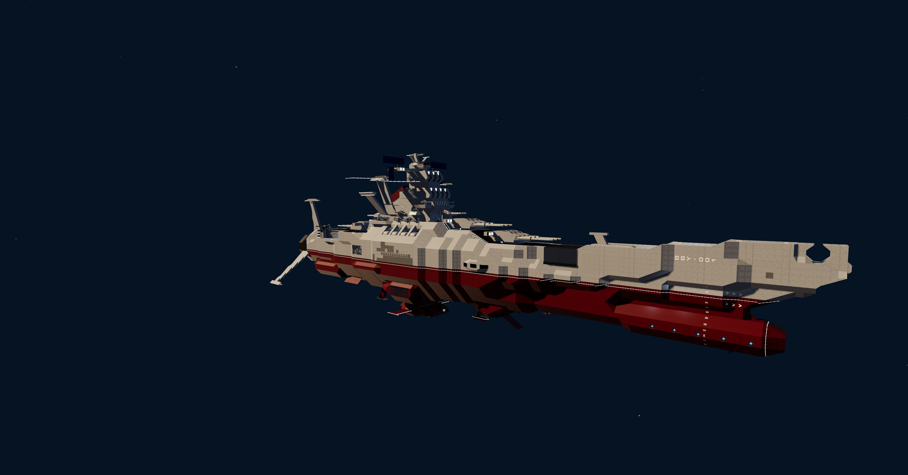

<h1 align="center">EGS-BBS</h1>

Empyrion Galactic Survival: Build &amp; Blueprint Ships

Windows x64 · Empyrion + Reforged Eden 2 · RU / EN

[Русский](README.ru.md) · [Download](https://github.com/Tefoke1/EGS-BBS/releases/tag/v0.7.0-beta.1) · [Release notes](CHANGELOG.md) · [How it works](docs/TRUST.md) · [Licenses](docs/DEPENDENCIES.md)

**Turn a game blueprint into a clear construction plan.**

EGS-BBS helps you inspect ships layer by layer, plan block and device placement, and prepare your own blueprints for Empyrion Galactic Survival and Reforged Eden 2. Open a ship from the game or Workshop, understand its structure, make changes and export an EPB game file.

## Explore blueprints layer by layer

Reveal the interior, device placement and connections between parts. Select a range or isolate a single layer to understand an existing ship and plan your own.

### X · across the hull

### Y · deck by deck

### Z · along the ship

## Plan your construction

Compare hull materials, adjust shapes and rotations, place devices and review the component list. Layer views guide manual construction; the timeline shows individual blocks being added from bottom to top. Save a `.ship.json` project to continue later.

## From the game to the editor — and back

1. **Import EPB.** Open a personal blueprint or a downloaded Workshop ship from the library.
2. **Inspect and edit.** Work with layers, device filters, paint and material selection.
3. **Export to the game.** **To game** saves a new `.epb` into your personal Empyrion library and shows the next steps.
4. **Use the Factory.** Open blueprints in Empyrion, select the saved ship, send it to the Factory and supply the required resources. When production finishes, place the ship according to your game mode or server rules.

The application's resource list helps you prepare; the in-game Factory shows the final requirements for your installation.

## What you can do

| Build & edit | Inspect & present |
|---|---|
| Game-derived shape catalog and material picker | X/Y/Z ranges, individual layers, device filters |
| Select, copy, paint, decals, 90° rotation, symmetry | Mass, power, CPU, component and Factory resource summaries |
| Undo/redo and local project backups | Bottom-to-top construction timeline, one block at a time |
| Workshop subscriptions and personal blueprint discovery | Fast / realistic / experimental cinematic rendering |
| Import EPB; export a new EPB into your personal game library | 4K PNG and MP4: manual camera, orbit or four-shot sequence |

### Photo & film

Save a PNG of your ship or record an MP4 flyaround. Adjust light, exposure and materials; choose a manual camera or automatic angles. Cinematic mode continues to evolve with the application.

Manual filming records camera movement first, then renders MP4 at fixed timestamps. Heavy scenes take longer to export instead of skipping output frames. The filming screenshot shows the Russian UI; the application also has English controls.

## Download and start

**[0.7.0-beta.1 · portable Windows x64 ZIP](https://github.com/Tefoke1/EGS-BBS/releases/tag/v0.7.0-beta.1)** — a prerelease, not a stable build.

1. Extract the **whole ZIP** into a writable folder. Keep the EXE and adjacent runtime files together.
2. Run `EGS-BBS.exe`; no separate Node.js or Python installation is needed.
3. Select your Steam / SteamLibrary folder. Empyrion and the downloaded RE2 subscription must already be installed.
4. Wait for the first local import. Progress and stage are shown; later launches reuse the cache.
5. Open a ship from **Library**, edit it and use **To game**. Follow the in-app Factory / Workshop checklist. Steam publishing is performed in the game, not silently by this tool.

Back up projects as `.ship.json` before updating. Local data is stored in `%APPDATA%/EGS-BBS`. Install updates into a new extracted folder. Original Workshop blueprints are preserved; game export creates a new personal blueprint folder.

## Hardware

These are practical recommendations, **not benchmark-validated minimum requirements**.

| Component | Recommendation |
|---|---|
| OS | Windows 11 x64 (tested); no macOS/Linux package |
| RAM | 16 GB for ordinary ships; 32 GB for very large projects and other open applications |
| GPU | Hardware WebGL 2; dedicated GPU with 8 GB VRAM recommended for large ships/photo mode |
| CPU / storage | Modern multicore CPU; SSD with several GB free for the app and generated asset cache |
| Required content | Your own Empyrion installation; downloaded Reforged Eden 2 for RE2 blocks |

Test PC: Ryzen 7 5700X3D, Radeon RX 5700 XT, 32 GB RAM. GALAXIAN CITY (609,206 roots): 3.420 GiB settled / 3.857 GiB peak summed private process memory, original model/texture detail retained. Peak equals 4.141 decimal GB. Workload and hardware matter; the 1,000,000-root capacity is not a promise of 60 FPS or a fixed memory ceiling.

## Controls

| Action | Shortcut |
|---|---|
| Select / build / delete tool | V / B / E |
| Delete selection / paint / sample | Del / P / I |
| Rotate 90° / symmetry | R / M |
| Copy / paste / undo / redo | Ctrl+C / Ctrl+V / Ctrl+Z / Shift+Z |
| Flight / exit | F / F or Esc |
| Move / height | WASD / Q,E |
| Flight speed | Wheel; Shift ×4; Ctrl+Shift ×16; Alt ×¼ |
| Fit / hide sidebars | Home / Tab |

Right-click opens block/material options, or the palette when painting.

## Downloads and updates

Ready-to-run builds are available in [Releases](https://github.com/Tefoke1/EGS-BBS/releases), alongside `SHA256SUMS.txt` and `SECURITY-REPORT.md` with verification results. The current beta is distributed without a digital signature.

## About the project

EGS-BBS is a community project for Empyrion players. It runs locally and uses resources from your installed game. Game models and textures belong to Eleon Game Studios and their respective creators and are not bundled with the application.

Thanks to the creators of the featured ships: MisterCrow for Thanatos and the Workshop creator of [YAMATO Real Size](https://steamcommunity.com/sharedfiles/filedetails/?id=1320029358).

[How the application works](docs/TRUST.md) · [Libraries and licenses](docs/DEPENDENCIES.md) · [Report an issue](https://github.com/Tefoke1/EGS-BBS/issues)
