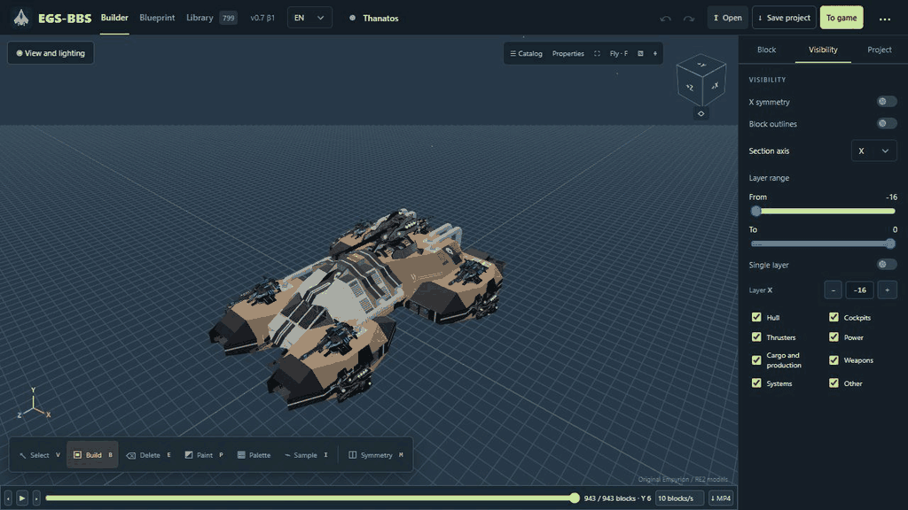
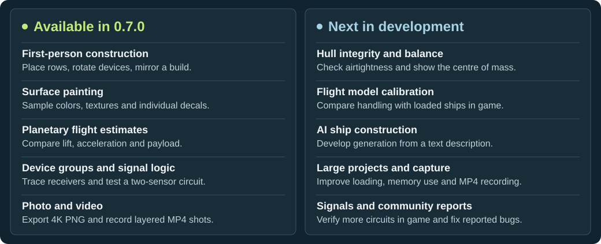

<h1 align="center">EGS-BBS</h1>

Empyrion Galactic Survival: Build &amp; Blueprint Ships

  
  
  

  
  
  
  
  
  
  

EGS-BBS is a local blueprint editor for Empyrion and Reforged Eden 2: inspect layers, plan construction and edit ships from the game and Workshop.

## System requirements

| Component | Recommended |
|---|---|
| OS | Windows 11 x64 |
| CPU | Multicore x64; tested with AMD Ryzen 7 5700X3D |
| RAM | 16 GB for ordinary ships; 32 GB for large projects |
| GPU | Hardware WebGL 2; 8 GB VRAM for large projects and photo mode. Tested with Radeon RX 5700 XT |
| Storage | SSD with several GB free for the app and cache; additional space for the game and blueprints |
| Game | Installed Empyrion; downloaded Reforged Eden 2 for its blocks |

## Layer inspection

Select a range along X, Y or Z, or isolate a single layer to examine rooms and device placement.

| X · across the hull | Y · deck by deck | Z · along the ship |
|:---:|:---:|:---:|
|  |  |  |

## Devices up close

Toggle the hull, weapons and thrusters independently. Move the camera closer to components or explore in free flight.

## Building tools

- Game-derived shapes, materials, paint and decals.
- Selection, copying, 90° rotation, symmetry, undo and redo.
- Component list, mass, power, CPU and estimated Factory resources.
- Bottom-to-top construction timeline, one block at a time.
- Projects up to 1,000,000 blocks; save your work as `.ship.json`.
- Fast, realistic and experimental cinematic rendering.

## From blueprint to game

1. Open a personal blueprint or Workshop subscription from **Library** and edit it.
2. Click **To game** to save a new `.epb` into your personal Empyrion blueprint folder.
3. In the game, send the blueprint to the Factory, supply the required resources and place the ship once production finishes.

The game determines final resource costs and construction limits. Workshop publishing instructions are available in the export window.

## Photo and video

Adjust lighting and exposure, export PNG up to 4K or record MP4. Choose a smooth manual camera, an orbit or a sequence of angles.

Filming settings

## Setup and updates

1. Get the ZIP using **Download** above and extract it in full.
2. Run `EGS-BBS.exe`; no separate Python or Node.js installation is needed.
3. Select your Steam / SteamLibrary folder and wait for game assets to import. Later launches reuse the cache.

Before updating, save your projects as `.ship.json` and extract the new version into a separate folder. App data is stored in `%APPDATA%/EGS-BBS`.

The release includes `SHA256SUMS.txt` and `SECURITY-REPORT.md`. The current beta is unsigned.

Keyboard shortcuts

| Action | Shortcut |
|---|---|
| Select / build / delete tool | V / B / E |
| Delete selection / paint / sample | Del / P / I |
| Rotate / symmetry | R / M |
| Copy / paste / undo / redo | Ctrl+C / Ctrl+V / Ctrl+Z / Shift+Z |
| Flight / exit | F / F or Esc |
| Move / height | WASD / Q,E |
| Flight speed | Wheel; Shift ×4; Ctrl+Shift ×16; Alt ×¼ |
| Fit ship / hide panels | Home / Tab |

Right-click opens block/material options, or the palette when painting.

## Roadmap

## Support development

If you enjoy EGS-BBS and would like to help it grow, you can support my work on Boosty.

## Authors and credits

The app uses assets from your locally installed game. Models and textures belong to [Eleon Game Studios](http://www.eleon-studios.com) and their respective creators; they are not included in the distribution.

The images above demonstrate the application using works by:

- MisterCrow — ["Thanatos" Assault Vessel](https://steamcommunity.com/sharedfiles/filedetails/?id=1090967294)
- MISOsp[HZ_Express] — [YAMATO Real Size](https://steamcommunity.com/sharedfiles/filedetails/?id=1320029358)

[Report an issue](https://github.com/Tefoke1/EGS-BBS/issues)
