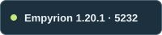
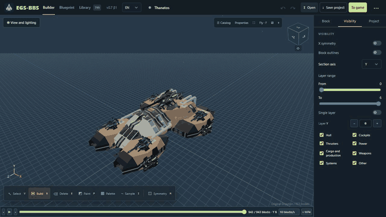
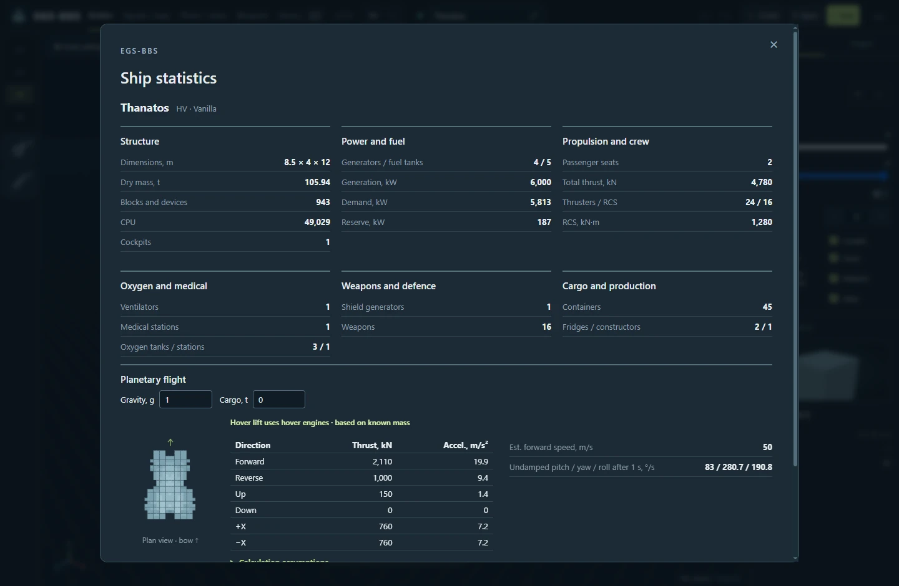
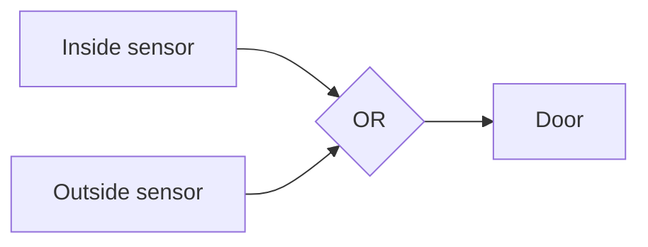

<h1 align="center">EGS-BBS</h1>

Empyrion Galactic Survival: Build &amp; Blueprint Ships

  
  
  

  
  
  
  
  
  
  

Open an Empyrion or Reforged Eden 2 blueprint, inspect its decks, rebuild it in first person and send your version to the in-game Factory. EGS-BBS runs locally on Windows.

## Layer inspection

Select a range along X, Y or Z, or isolate a single layer to examine rooms and device placement.

Peel the most protruding layers from every side to expose the core. Large projects show loading progress and can be cancelled. The editor accepts up to 1,000,000 blocks.

| X · across the hull | Y · deck by deck | Z · along the ship |
|:---:|:---:|:---:|
|  |  |  |

### Devices up close

Toggle the hull, weapons and thrusters independently. Move the camera closer to components or explore in free flight.

## Build and paint in first person

Press **F** to enter a ship and work where the blocks will go. In **Build and edit (B)**, place a row with one drag, rotate or move a device, and use X symmetry for a matching opposite side. The preview shows the textured part. One undo removes the whole row.

In **Paint (V)**, right-click for the project palette. Sample the texture and color or the decal under the brush with the middle button. Paint shortcuts follow the material you aim at.

Builder controls

| Action | Control |
|---|---|
| Enter or leave construction | F |
| Fly / ascend / descend | WASD / Space / Ctrl |
| Adjust flight speed | Mouse wheel |
| Build and edit / paint | B / V |
| Put away the part, then open the catalog | Right-click once per action |
| Assign a quick slot | Hover a catalog part and press 1 through = |
| Select rotation axis / rotate | Z / X |
| Copy a block or sample paint | Middle mouse button |
| Undo / expand viewport | Ctrl+Z / Tab |

## Will the ship lift off?

Open **Ship statistics**, set gravity to **1 g** and add the expected cargo. Check upward thrust against loaded weight, then compare forward and braking acceleration. The panel includes thrust in all six directions and estimates of speed, pitch, yaw and roll. The game’s atmosphere and flight settings can change those estimates.

Expand the component and Factory lists to see quantities with their game icons.

## Devices and signal logic

Select a device group, assign it to one of eight control-panel shortcuts, or follow a named signal to its receivers. Clicking a device or circuit on the connection map opens its settings. The editor supports 13 circuit types and flags missing sources on connected inputs.

In the built-in guide, switch either of two sensors on to see the door open through an **OR** gate.

## From blueprint to Factory

1. Open a personal `.epb` or a Steam Workshop blueprint from **Library**. Edits to a subscription use a copy.
2. Choose **Save** to write a local `.epb` or add it to your personal game library with a ship portrait. A newly built ship needs a primary core for export.
3. In your world, open **F2 → Blueprints**, select the ship and add it to the Factory. Supply the listed resources, start production and place the finished ship.

## Photo and video

Open **Photo / video** to set the light, exposure and framing for a PNG up to 4K. Record an MP4 with smooth manual flight, an orbit or a sequence of camera angles. A reveal along X, Y or Z can show a build taking shape deck by deck.

## Setup and updates

Extract the entire Windows x64 ZIP and run **EGS-BBS.exe**. Choose a language and connect the detected Steam library. If needed, browse to the game folder. The first launch prepares and caches the models. In Welcome, the optional 30-second test estimates the project size your PC can display at 30 FPS.

To update, close the app and extract the new ZIP to a separate folder. Each release includes checksums and a report for the unsigned executable.

## System requirements

| Component | Recommended |
|---|---|
| OS | Windows 10 or 11 x64. This release was tested on Windows 10 22H2. |
| CPU | Multicore x64; tested with AMD Ryzen 7 5700X3D |
| RAM | 16 GB for ordinary ships; 32 GB for large projects |
| GPU | Hardware WebGL 2; 8 GB VRAM for large projects and photo mode. Tested with Radeon RX 5700 XT |
| Storage | SSD with several GB free for the app and cache; additional space for the game and blueprints |
| Game | Installed Empyrion; downloaded Reforged Eden 2 for its blocks |

## Roadmap

## Support development

If you enjoy EGS-BBS and would like to help it grow, you can support my work on Boosty.

## Authors and credits

The app uses assets from your locally installed game. Models and textures belong to [Eleon Game Studios](http://www.eleon-studios.com) and their respective creators; they are not included in the distribution.

The images above demonstrate the application using works by:

- MisterCrow — ["Thanatos" Assault Vessel](https://steamcommunity.com/sharedfiles/filedetails/?id=1090967294)
- MISOsp[HZ_Express] — [YAMATO Real Size](https://steamcommunity.com/sharedfiles/filedetails/?id=1320029358)

[Report an issue](https://github.com/Tefoke1/EGS-BBS/issues)
