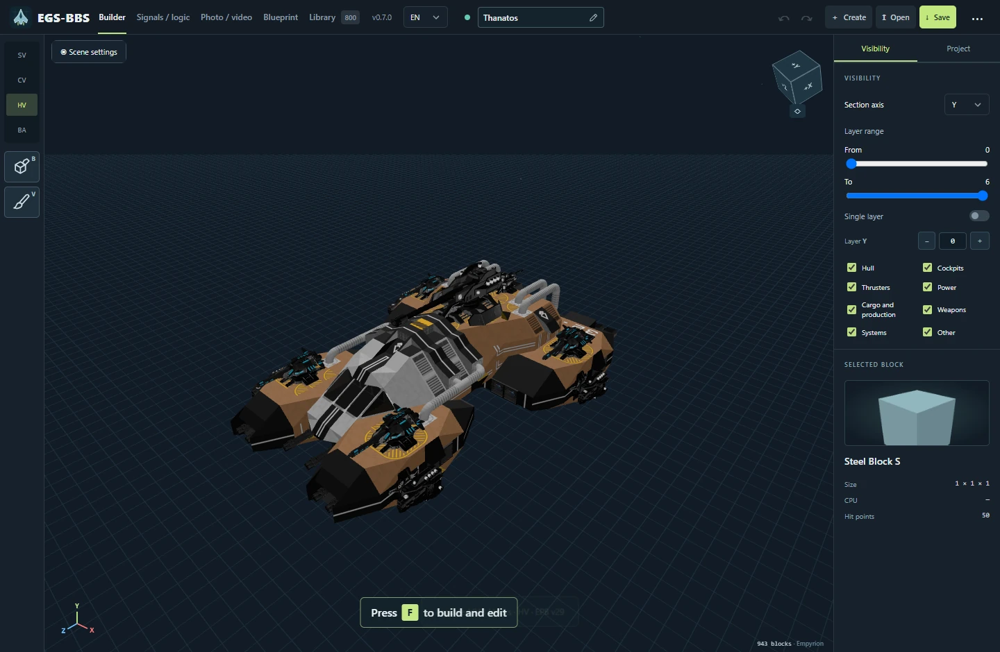
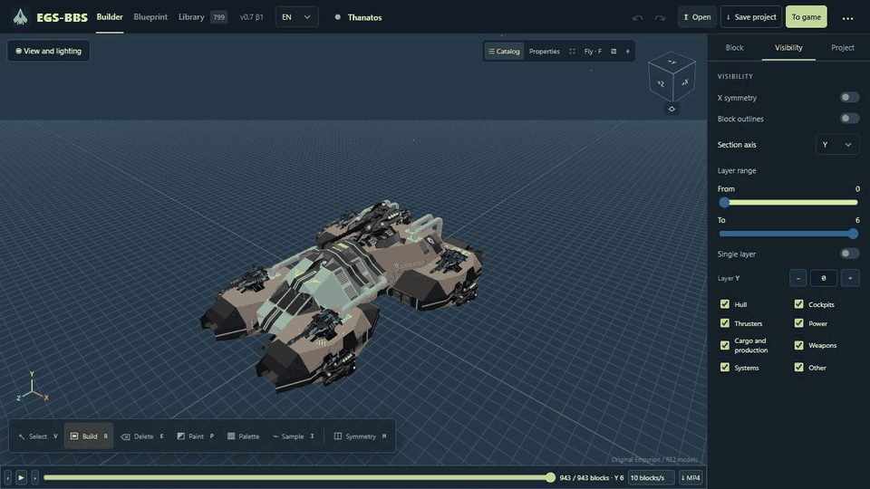

<h1 align="center">EGS-BBS</h1>

Empyrion Galactic Survival: Build &amp; Blueprint Ships

  
  
  

  
  
  
  
  
  
  

A local Windows blueprint editor for **Empyrion and Reforged Eden 2**. Open a ship or base of up to **2,000,000 blocks**, inspect it layer by layer and save your version for the in-game Factory.

## What you can do

- **Look inside a ship.** Select a layer or a range along X, Y or Z. Peel back the outer layers from all sides, or hide the hull to inspect devices.
- **Build and paint.** Press **F** to build in first person. Drag out rows of blocks, move devices and mirror your work. The brush samples a texture and its colour or an individual decal directly from a part.
- **Check a design.** Inspect block airtightness and the centre of mass. Set cargo mass and gravity to estimate lift-off, acceleration and braking. Actual flight performance depends on in-game conditions.
- **Wire devices.** Group devices, assign shortcuts and trace a signal from sensor to receiver. Select a device on the wiring diagram to find it on the ship in 3D.
- **Shoot photos and video.** Save PNGs up to 4K and record MP4 with manual flight, an orbit or a sequence of camera angles. Animate layers to reveal a build deck by deck.

| X · across the hull | Y · deck by deck | Z · along the ship |
|:---:|:---:|:---:|
|  |  |  |

Show the hull, weapons and thrusters separately

## From download to Factory

1. Extract the ZIP and run **EGS-BBS.exe**. Choose a language and a shared folder for models, recovery saves and captures. The editor locates your Steam library. You can reuse the same storage folder after an update.
2. Start a project or open a personal blueprint or Workshop subscription. The editor works on a copy of the subscription. Choose **Save** to write an `.epb` to a folder or directly to your game library.
3. In game, open **F2 → Blueprints**, select the ship and add it to the Factory. Supply the listed resources and start production.

## System requirements

| Component | Recommended |
|---|---|
| OS | Windows 10 or 11, x64 |
| CPU and memory | Multicore x64. 16 GB RAM for typical builds, 32 GB for megaprojects |
| GPU | WebGL 2. For megaprojects and photo mode, a discrete GPU with 8 GB VRAM |
| Storage and game | SSD with several GB free for the cache. An installed copy of Empyrion, plus the downloaded scenario for RE2 blocks |

On megaprojects, cinematic mode can run below 30 FPS. Use the fast builder for editing.

## Download safety and usage

Download the Windows ZIP from Releases. The EXE is unsigned. Each release includes `SHA256SUMS.txt` and a verification report. The editor reads models and textures from your installed game. [How to verify the archive](docs/TRUST.md#english)

You can use the editor for free, change or reuse its original code and share your own versions without asking the author. The software is provided as is, without warranty. Do not use it to deliberately harm other players or claim someone else’s work as your own.

## Roadmap

## Support and credits

Created by **AlienLorem (Tefoke1)**. If the editor helped with your build, you can support development.

Blueprints featured in the screenshots:

- MisterCrow — ["Thanatos" Assault Vessel](https://steamcommunity.com/sharedfiles/filedetails/?id=1090967294)
- MISOsp[HZ_Express] — [YAMATO Real Size](https://steamcommunity.com/sharedfiles/filedetails/?id=1320029358)

[Report an issue](https://github.com/Tefoke1/EGS-BBS/issues)
