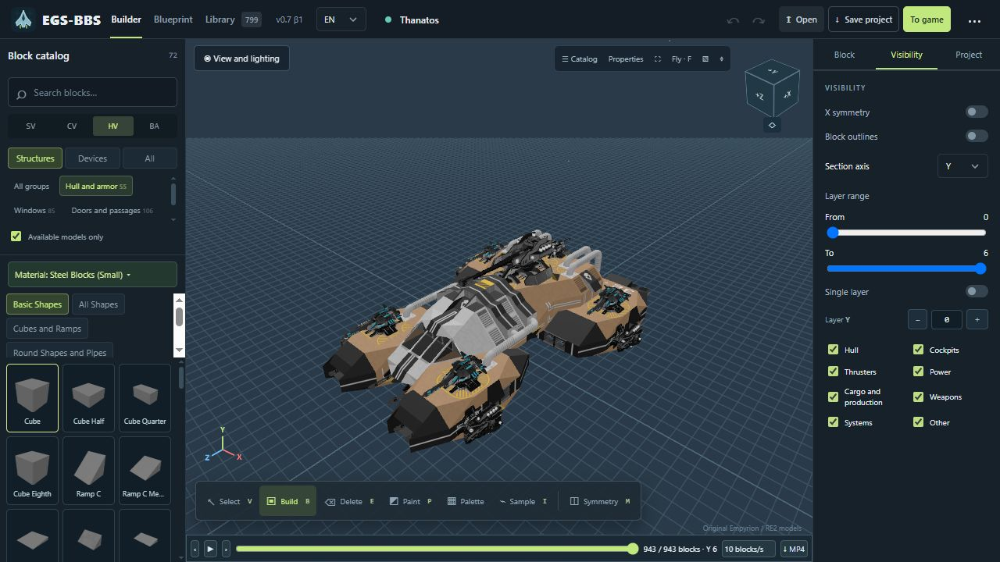
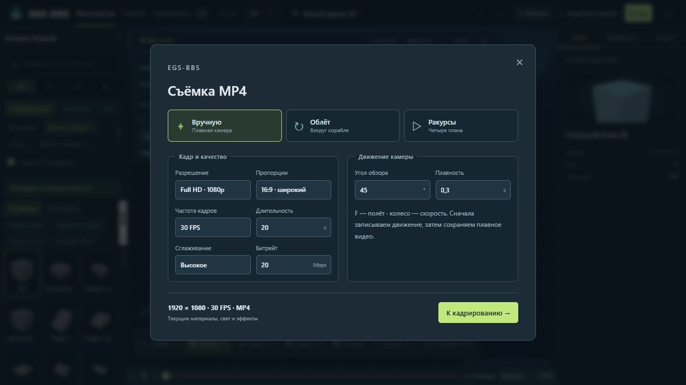

<h1 align="center">EGS-BBS</h1>

Empyrion Galactic Survival: Build &amp; Blueprint Ships

  
  
  

  
  
  
  
  
  
  

EGS-BBS — локальный конструктор чертежей для Empyrion и Reforged Eden 2: просмотр по слоям, планирование постройки и редактирование кораблей из игры и Workshop.

## Системные требования

| Компонент | Рекомендуется |
|---|---|
| ОС | Windows 11 x64 |
| Процессор | Многоядерный x64; проверен AMD Ryzen 7 5700X3D |
| ОЗУ | 16 ГБ для обычных кораблей; 32 ГБ для крупных проектов |
| Видеокарта | Аппаратный WebGL 2; для крупных проектов и фоторежима — 8 ГБ видеопамяти. Проверена Radeon RX 5700 XT |
| Диск | SSD, несколько свободных ГБ под приложение и кэш; отдельно — место под игру и чертежи |
| Игра | Установленная Empyrion; скачанный Reforged Eden 2 для его блоков |

## Послойный просмотр

Выбирайте диапазон по X, Y или Z либо один слой, чтобы рассмотреть внутренние помещения и расположение устройств.

| X · поперёк корпуса | Y · по палубам | Z · вдоль корабля |
|:---:|:---:|:---:|
|  |  |  |

## Устройства крупным планом

Скрывайте корпус, оружие и двигатели независимо друг от друга. Приближайте камеру к деталям или перемещайтесь в режиме полёта.

## Конструирование

- Игровые формы, материалы, окраска и декали.
- Выбор, копирование, поворот на 90°, симметрия, отмена и повтор действий.
- Состав корабля, масса, мощность, CPU и оценка ресурсов фабрики.
- Таймлайн постройки снизу вверх, блок за блоком.
- Проекты до 1 000 000 блоков; сохранение работы в `.ship.json`.
- Быстрый, реалистичный и экспериментальный кинематографичный режимы.

## Из чертежа — в игру

1. Откройте личный чертёж или подписку Workshop из **Библиотеки** и внесите изменения.
2. Нажмите **«В игру»**: новый `.epb` сохранится в личную папку чертежей Empyrion.
3. В игре отправьте чертёж на фабрику, внесите требуемые ресурсы и после производства разместите корабль.

Итоговые ресурсы и ограничения постройки определяет игра. Порядок публикации в Workshop доступен в окне экспорта.

## Фото и видео

Настраивайте свет и экспозицию, сохраняйте PNG до 4K или MP4. Для съёмки доступны плавная ручная камера, облёт по орбите и смена ракурсов.

Настройки съёмки

## Запуск и обновление

1. Скачайте ZIP по кнопке **«Скачать»** и распакуйте его целиком.
2. Запустите `EGS-BBS.exe` — отдельная установка Python и Node.js не нужна.
3. Укажите папку Steam / SteamLibrary и дождитесь импорта игровых ресурсов. Следующие запуски используют кэш.

Для обновления распакуйте новую версию отдельно, предварительно сохранив проекты в `.ship.json`. Данные приложения находятся в `%APPDATA%/EGS-BBS`.

В выпуске приложены `SHA256SUMS.txt` и `SECURITY-REPORT.md`. Текущая бета — без цифровой подписи.

Горячие клавиши

| Действие | Клавиша |
|---|---|
| Выбрать / строить / удалять | V / B / E |
| Удалить выбранное / кисть / пипетка | Del / P / I |
| Поворот / симметрия | R / M |
| Копировать / вставить / отменить / повторить | Ctrl+C / Ctrl+V / Ctrl+Z / Shift+Z |
| Полёт / выход | F / F или Esc |
| Перемещение / высота | WASD / Q,E |
| Скорость полёта | Колесо; Shift ×4; Ctrl+Shift ×16; Alt ×¼ |
| Вписать корабль / скрыть панели | Home / Tab |

Правая кнопка — меню блока и материалов; при покраске — палитра.

## Карта разработки

## Поддержать разработку

Если вам понравилась работа и хочется поучаствовать в развитии EGS-BBS, меня можно поддержать на Boosty.

## Авторы и благодарности

Приложение использует ресурсы локально установленной игры. Модели и текстуры принадлежат [Eleon Game Studios](http://www.eleon-studios.com) и авторам контента; в дистрибутив они не входят.

В вышеуказанных снимках, демонстрирующих возможности программы, использованы работы авторов:

- MisterCrow — ["Thanatos" Assault Vessel](https://steamcommunity.com/sharedfiles/filedetails/?id=1090967294)
- MISOsp[HZ_Express] — [YAMATO Real Size](https://steamcommunity.com/sharedfiles/filedetails/?id=1320029358)

[Сообщить о проблеме](https://github.com/Tefoke1/EGS-BBS/issues)
