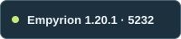
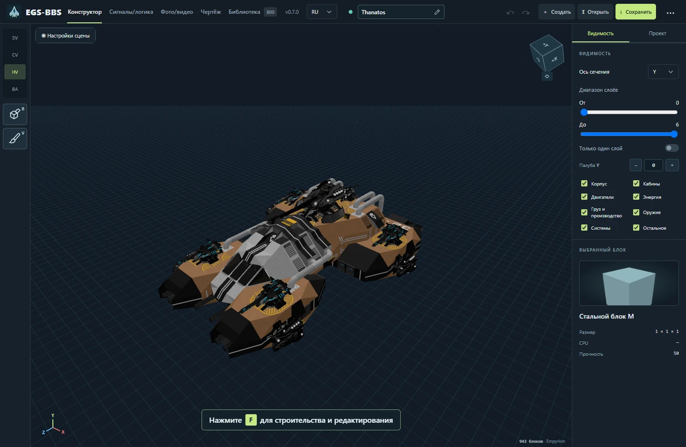
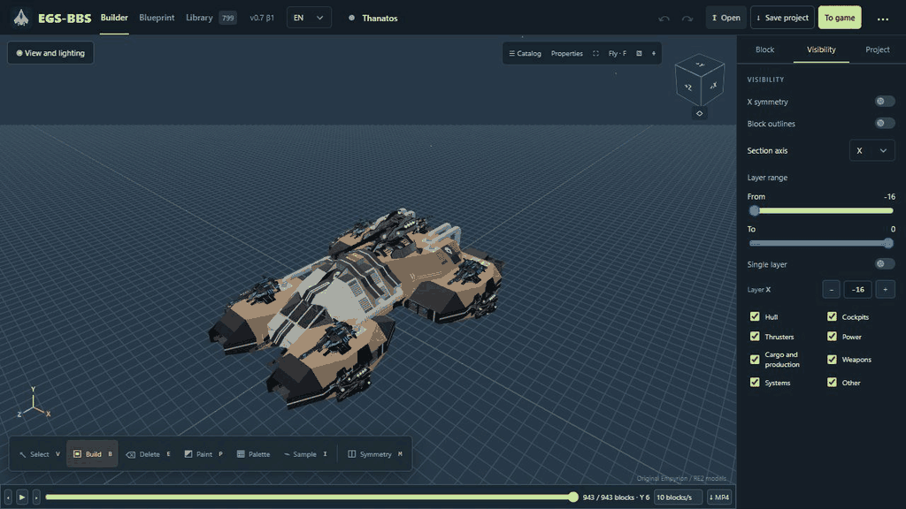
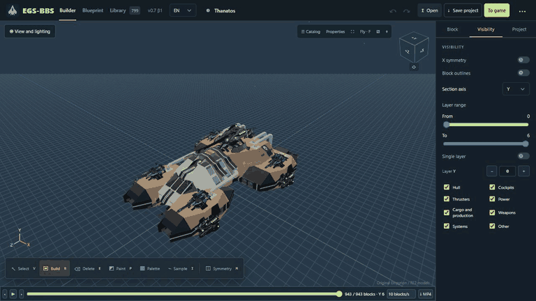
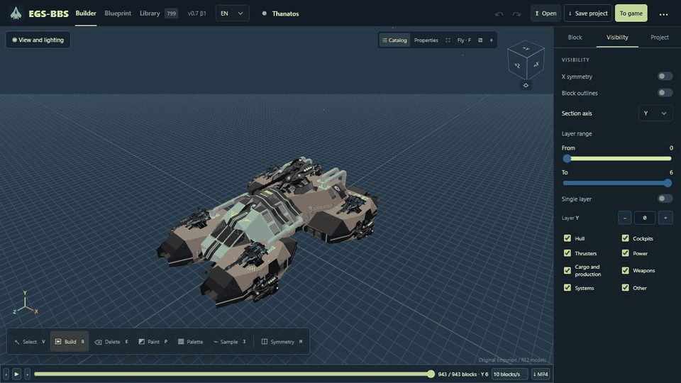

<h1 align="center">EGS-BBS</h1>

Empyrion Galactic Survival: Build &amp; Blueprint Ships

  
  
  

  
  
  
  
  
  
  

Локальный редактор чертежей **Empyrion и Reforged Eden 2** для Windows. Откройте корабль или базу до **2 000 000 блоков**, разберите конструкцию по слоям и сохраните свою версию для игровой фабрики.

## Что можно сделать

- **Посмотреть корабль изнутри.** Выберите один слой или диапазон по X, Y или Z. Можно снимать наружные слои со всех сторон либо скрыть корпус, чтобы рассмотреть устройства.
- **Построить и покрасить.** Нажмите **F** для строительства от первого лица. Протягивайте ряды блоков, переносите устройства и стройте симметрично. Кисть берёт текстуру с цветом или отдельную декаль прямо с детали.
- **Проверить проект.** Посмотрите герметичность блоков и положение центра масс. Укажите груз и гравитацию, чтобы оценить взлёт, разгон и торможение. Фактический полёт зависит от игровых условий.
- **Настроить устройства.** Объединяйте устройства в группы, назначайте кнопки и прослеживайте сигнал от датчика до приёмника. Выбранное на схеме устройство можно найти на корабле в 3D.
- **Снять фото или видео.** Сохраняйте PNG до 4K и MP4 с ручной камерой, облётом или сменой ракурсов. Анимация слоёв показывает постройку по палубам.

| X · поперёк корпуса | Y · по палубам | Z · вдоль корабля |
|:---:|:---:|:---:|
|  |  |  |

Показать корпус, оружие и двигатели по отдельности

## От установки до фабрики

1. Распакуйте ZIP и запустите **EGS-BBS.exe**. Выберите язык и общую папку для моделей, автосохранений и съёмок. Редактор найдёт библиотеку Steam. При обновлении эту папку можно использовать снова.
2. Создайте проект или откройте личный чертёж либо подписку Workshop. Редактор работает с копией подписки. Нажмите **Сохранить**, чтобы записать `.epb` в свою папку или в библиотеку игры.
3. В игре откройте **F2 → Чертежи**, выберите корабль и добавьте его на фабрику. Внесите ресурсы и запустите производство.

## Системные требования

| Компонент | Рекомендуется |
|---|---|
| ОС | Windows 10 или 11, x64 |
| Процессор и память | Многоядерный x64. ОЗУ от 16 ГБ, для мегапроектов — 32 ГБ |
| Видеокарта | WebGL 2. Для мегапроектов и фоторежима — дискретная карта с 8 ГБ видеопамяти |
| Диск и игра | SSD, несколько свободных ГБ для кэша. Установленная Empyrion, для блоков RE2 — скачанный сценарий |

На мегапроектах кинематографический режим может работать медленнее 30 FPS. Для редактирования используйте быстрый режим конструктора.

## Безопасность и использование

Скачивайте Windows ZIP из Releases. EXE без цифровой подписи. Для проверки загрузки в выпуске есть `SHA256SUMS.txt` и отчёт. Модели и текстуры читаются из установленной игры. [Как проверить архив](docs/TRUST.md#русский)

Можно бесплатно пользоваться редактором, изменять авторский код, использовать его в своих проектах и распространять свои версии без согласования с автором. Программа поставляется «как есть», без гарантий. Запрещено намеренно вредить другим игрокам или выдавать чужие работы за свои.

## Карта разработки

## Поддержка и авторы

Автор — **AlienLorem (Tefoke1)**. Если редактор пригодился, можно поддержать разработку.

На снимках использованы работы авторов:

- MisterCrow — ["Thanatos" Assault Vessel](https://steamcommunity.com/sharedfiles/filedetails/?id=1090967294)
- MISOsp[HZ_Express] — [YAMATO Real Size](https://steamcommunity.com/sharedfiles/filedetails/?id=1320029358)

[Сообщить о проблеме](https://github.com/Tefoke1/EGS-BBS/issues)
