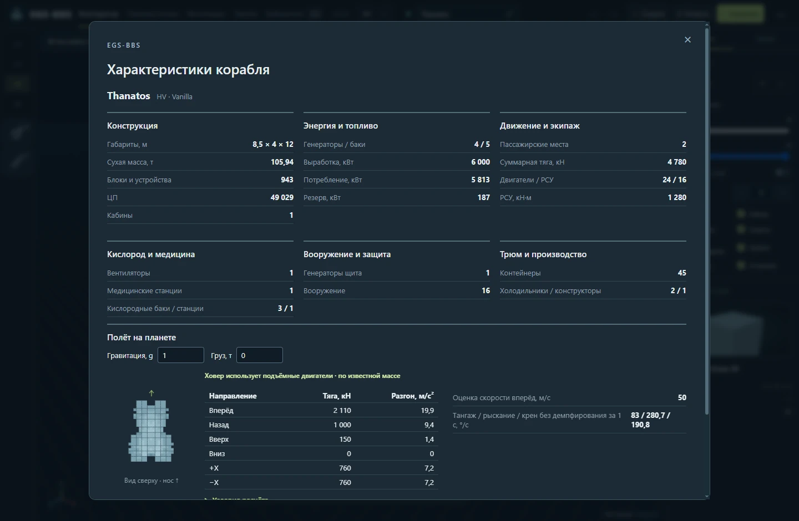
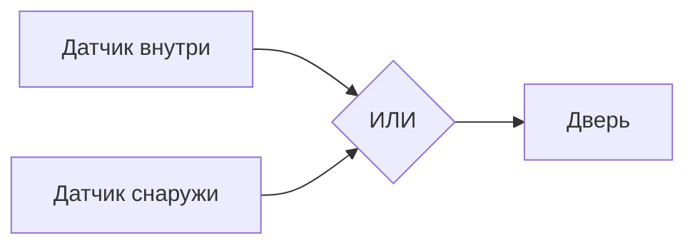
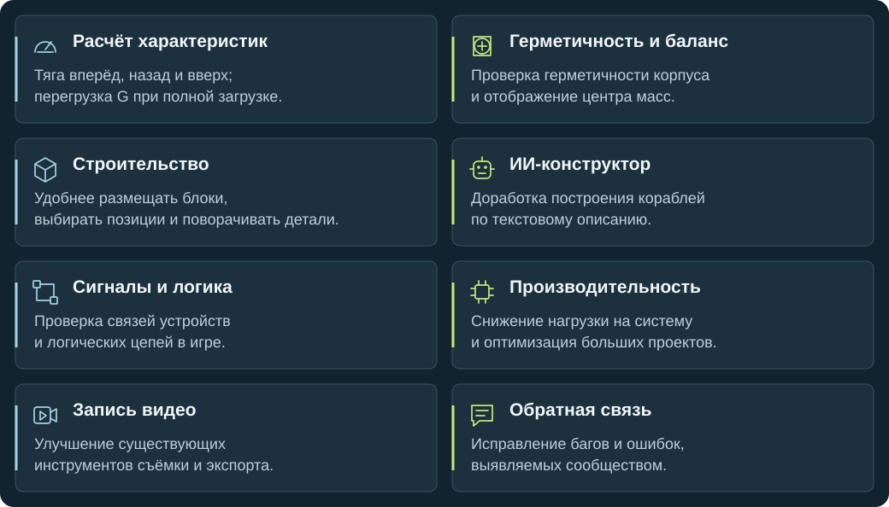

<h1 align="center">EGS-BBS</h1>

Empyrion Galactic Survival: Build &amp; Blueprint Ships

  
  
  

  
  
  
  
  
  
  

Откройте чертёж Empyrion или Reforged Eden 2, загляните под обшивку, перестройте корабль от первого лица и отправьте свою версию на игровую фабрику. EGS-BBS работает локально в Windows.

## Послойный просмотр

Выбирайте диапазон по X, Y или Z либо один слой, чтобы рассмотреть внутренние помещения и расположение устройств.

Можно также снимать самые выступающие слои со всех сторон, постепенно открывая середину. Для крупных проектов виден ход загрузки и доступна отмена. Редактор открывает чертежи до 1 000 000 блоков.

| X · поперёк корпуса | Y · по палубам | Z · вдоль корабля |
|:---:|:---:|:---:|
|  |  |  |

### Устройства крупным планом

Скрывайте корпус, оружие и двигатели независимо друг от друга. Приближайте камеру к деталям или перемещайтесь в режиме полёта.

## Строительство и покраска от первого лица

Нажмите **F**, чтобы влететь внутрь корабля и строить на месте. Инструмент **«Строить и редактировать» (B)** позволяет протянуть ряд блоков мышью, развернуть или перенести устройство, включить симметрию по X. До установки видно деталь с текстурами. Весь ряд можно отменить одним действием.

В режиме **«Красить» (V)** правая кнопка открывает палитру проекта. Нажмите колесо, чтобы взять цвет с текстурой или декаль под кистью. Быстрые клавиши окраски учитывают материал под прицелом.

Управление в конструкторе

| Действие | Управление |
|---|---|
| Войти в строительство или выйти | F |
| Полёт / вверх / вниз | WASD / Пробел / Ctrl |
| Изменить скорость полёта | Колесо мыши |
| Строить и редактировать / красить | B / V |
| Убрать деталь, затем открыть каталог | ПКМ по одному разу на действие |
| Назначить быструю клавишу | Навести на деталь в каталоге и нажать клавишу от 1 до = |
| Выбрать ось / повернуть | Z / X |
| Скопировать блок или взять образец кистью | Нажать колесо |
| Отменить / развернуть видовой экран | Ctrl+Z / Tab |

## Поднимется ли корабль с грузом?

Откройте **«Характеристики корабля»**, выставьте **1 g** и добавьте предполагаемый груз. Сравните подъёмную тягу с весом загруженного корабля, а затем посмотрите, как быстро он разгонится и затормозит. Доступны тяга по шести направлениям и оценки скорости, тангажа, рыскания и крена. На результат в игре влияют атмосфера и настройки полёта.

Разверните состав корабля или ресурсы фабрики, чтобы увидеть количество деталей и материалов рядом с их игровыми миниатюрами.

## Устройства и логические сигналы

Назначьте группу устройств на один из восьми переключателей панели управления или выберите сигнал и проследите, куда он идёт. Щелчок по устройству или схеме на карте открывает его настройки. Доступны 13 типов логических схем и проверка подключённых входов на отсутствие источника.

Во встроенном руководстве можно включить любой из двух датчиков и увидеть, как дверь откроется через схему **«ИЛИ»**.

## Из чертежа на фабрику

1. Откройте личный `.epb` или подписку Steam Workshop из **«Библиотеки»**. Изменения подписки вносятся в копию.
2. Нажмите **«Сохранить»**, чтобы записать локальный `.epb` или добавить чертёж с портретом корабля в личную игровую библиотеку. Для экспорта нового корабля установите основное ядро.
3. В своём мире откройте **F2 → Чертежи**, выберите корабль и добавьте его на фабрику. Внесите указанные ресурсы, запустите производство и разместите готовый корабль.

## Фото и видео

В разделе **«Фото/видео»** настройте свет, экспозицию и ракурс для PNG до 4K. Для MP4 доступны плавное ручное управление, облёт по орбите и смена ракурсов. Совместите движение камеры с проявлением слоёв по X, Y или Z, чтобы показать сборку корабля по палубам.

## Запуск и обновление

Распакуйте ZIP для Windows x64 целиком и запустите **EGS-BBS.exe**. Выберите язык и подключите найденную библиотеку Steam. При необходимости укажите папку игры через Проводник. Программа подготовит модели и сохранит их в кэше. В приветственном окне доступен 30-секундный тест, который оценивает подходящий для вашего ПК размер проекта при 30 FPS.

Для обновления закройте приложение и распакуйте новый архив в отдельную папку. К каждому выпуску приложены контрольные суммы и отчёт о проверке. EXE без цифровой подписи.

## Системные требования

| Компонент | Рекомендуется |
|---|---|
| ОС | Windows 10 или 11 x64. Этот выпуск проверен на Windows 10 22H2. |
| Процессор | Многоядерный x64; проверен AMD Ryzen 7 5700X3D |
| ОЗУ | 16 ГБ для обычных кораблей; 32 ГБ для крупных проектов |
| Видеокарта | Аппаратный WebGL 2; для крупных проектов и фоторежима — 8 ГБ видеопамяти. Проверена Radeon RX 5700 XT |
| Диск | SSD, несколько свободных ГБ под приложение и кэш; отдельно — место под игру и чертежи |
| Игра | Установленная Empyrion; скачанный Reforged Eden 2 для его блоков |

## Карта разработки

## Поддержать разработку

Если вам понравилась работа и хочется поучаствовать в развитии EGS-BBS, меня можно поддержать на Boosty.

## Авторы и благодарности

Приложение использует ресурсы локально установленной игры. Модели и текстуры принадлежат [Eleon Game Studios](http://www.eleon-studios.com) и авторам контента; в дистрибутив они не входят.

В вышеуказанных снимках, демонстрирующих возможности программы, использованы работы авторов:

- MisterCrow — ["Thanatos" Assault Vessel](https://steamcommunity.com/sharedfiles/filedetails/?id=1090967294)
- MISOsp[HZ_Express] — [YAMATO Real Size](https://steamcommunity.com/sharedfiles/filedetails/?id=1320029358)

[Сообщить о проблеме](https://github.com/Tefoke1/EGS-BBS/issues)
