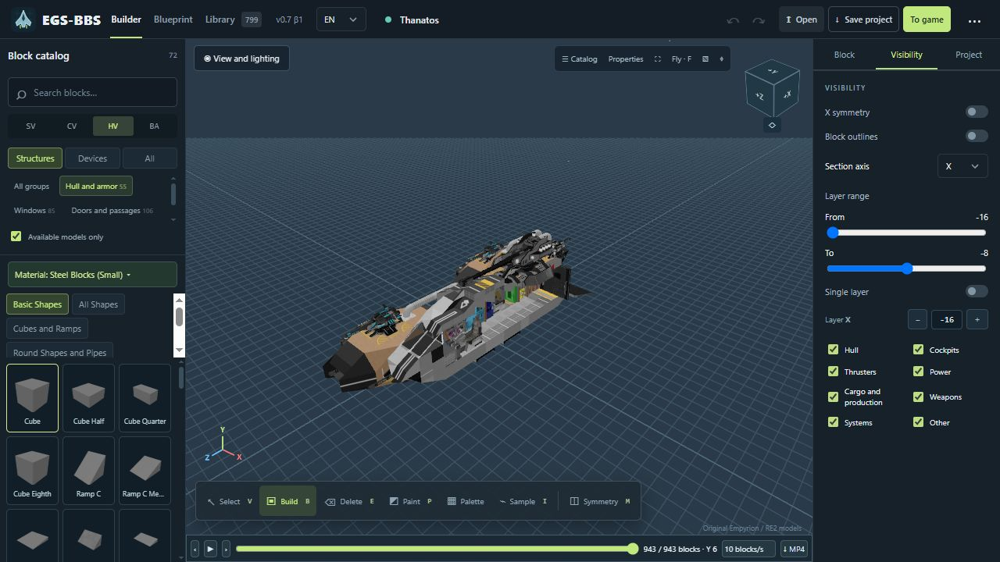
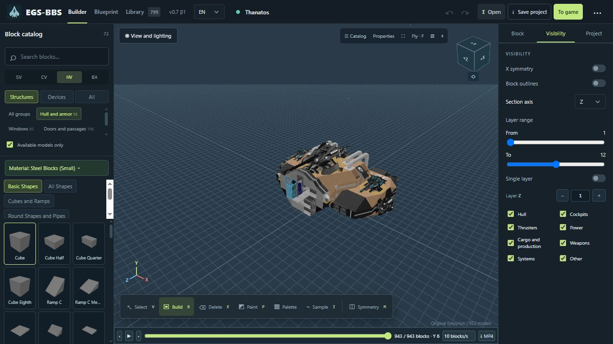

<h1 align="center">EGS-BBS</h1>

Empyrion Galactic Survival: Build &amp; Blueprint Ships

Windows x64 · Empyrion + Reforged Eden 2 · RU / EN

[English](README.md) · [Скачать](https://github.com/Tefoke1/EGS-BBS/releases/tag/v0.7.0-beta.1) · [Что нового](CHANGELOG.ru.md) · [Архитектура и доверие](docs/TRUST.md) · [Лицензии](docs/DEPENDENCIES.md)

**Откройте корабль. Разберитесь в его устройстве. Создайте свой вариант.**

Локальный 3D-конструктор чертежей с моделями, текстурами и цветами установленной игры. Открывайте подписки Workshop и свои корабли, меняйте детали, заглядывайте внутрь корпуса и сохраняйте новый чертёж для Empyrion.

## Загляните внутрь

Выберите ось и диапазон слоёв. Блоки скрываются для просмотра, а не удаляются. GIF показывает целый корабль и две половины по разным осям.

| Половина по X | Половина по Z |
|---|---|
|  |  |

## Возможности

| Конструирование | Просмотр и презентация |
|---|---|
| Игровые формы и отдельный выбор материала | Сечения X/Y/Z, один слой, фильтры устройств |
| Выбор, копирование, окраска, декали, поворот 90°, симметрия | Масса, мощность, CPU, состав и ресурсы фабрики |
| Отмена/повтор, локальное сохранение | Таймлайн постройки снизу вверх, блок за блоком |
| Подписки Steam и личные чертежи | Быстрый, реалистичный и экспериментальный кинематографичный режимы |
| Импорт EPB и экспорт нового EPB в личную папку игры | PNG 4K и MP4: ручная камера, облёт, смена ракурсов |

### Фото и видео

Исходные окраска и надписи сохраняются. Настраиваются свет, экспозиция, заполнение теней и износ. HDR, отражения и накопление сглаживания **не являются трассировкой глобального освещения** и не устраняют ступенчатый силуэт.

При ручной съёмке сначала записывается движение камеры, затем рассчитываются равномерные кадры MP4. Тяжёлый корабль увеличивает время экспорта. В интерфейсе доступны русский и английский языки.

## Скачать и запустить

**[0.7.0-beta.1 · переносимый ZIP для Windows x64](https://github.com/Tefoke1/EGS-BBS/releases/tag/v0.7.0-beta.1)** — предварительный, не стабильный выпуск.

1. Распакуйте **весь архив** в доступную для записи папку. EXE должен оставаться вместе с соседними файлами.
2. Запустите `EGS-BBS.exe`. Отдельно устанавливать Python и Node.js не нужно.
3. Укажите Steam / SteamLibrary. Игра и подписка Reforged Eden 2 должны быть скачаны заранее.
4. Дождитесь первого локального импорта: видны этап и прогресс. Повторные запуски используют кэш.
5. Откройте корабль из **Библиотеки**, измените и нажмите **В игру**. Инструкция фабрики и Workshop есть в приложении; публикация выполняется через игру.

Перед обновлением сохраните резервную копию `.ship.json`. Локальные данные находятся в `%APPDATA%/EGS-BBS`. Новую версию распаковывайте отдельно. Исходники чертежей Workshop сохраняются; экспорт создаёт новую папку личного чертежа.

## Системные требования

Практические рекомендации; **измеренный минимальный порог оборудования пока не установлен**.

| Компонент | Рекомендация |
|---|---|
| ОС | Windows 11 x64 — проверена; сборок macOS/Linux нет |
| ОЗУ | 16 ГБ для обычных кораблей; 32 ГБ для очень больших проектов |
| Видеокарта | Аппаратный WebGL 2; для больших кораблей и фоторежима рекомендуется дискретная карта с 8 ГБ VRAM |
| CPU / диск | Современный многоядерный процессор; SSD, несколько свободных ГБ под приложение и кэш |
| Контент | Собственная установленная Empyrion и скачанный RE2 для его блоков |

Проверочный ПК: Ryzen 7 5700X3D, RX 5700 XT, 32 ГБ. GALAXIAN CITY — 609 206 блоков: 3,420 GiB после загрузки, пик 3,857 GiB приватной памяти процессов. Пик равен 4,141 десятичного ГБ. Модели и разрешение текстур сохранены. Лимит 1 000 000 блоков не гарантирует 60 FPS или одинаковый расход памяти на любом проекте.

## Управление

| Действие | Клавиша |
|---|---|
| Выбрать / строить / удалять | V / B / E |
| Удалить выбранное / кисть / пипетка | Del / P / I |
| Поворот 90° / симметрия | R / M |
| Копировать / вставить / отменить / повторить | Ctrl+C / Ctrl+V / Ctrl+Z / Shift+Z |
| Полёт / выход | F / F или Esc |
| Перемещение / высота | WASD / Q,E |
| Скорость полёта | Колесо; Shift ×4; Ctrl+Shift ×16; Alt ×¼ |
| Вписать корабль / скрыть панели | Home / Tab |

Правая кнопка — меню блока и материалов; при покраске — палитра.

## Доверие и проверка загрузки

EXE **не подписан Authenticode**. Исходный репозиторий закрыт; здесь публикуются сборки, документация и результаты проверок. Ни значок, ни антивирусный отчёт не доказывают абсолютную безопасность.

- Скачивайте из Releases этого репозитория и сверяйте `SHA256SUMS.txt`.
- Изучите [архитектуру, сетевые обращения и границы защиты](docs/TRUST.md).
- В `SECURITY-REPORT.md` каждого выпуска указаны реальные результаты, хэши и ссылки VirusTotal. Отсутствующий отчёт по хэшу нельзя считать успешной проверкой.
- Не отключайте антивирус и SmartScreen. Срабатывания нужно изучать, а не автоматически объявлять ложными.

## Ограничения и права

Расчёт ресурсов может быть неполным для устаревших и модифицированных блоков. Лётные параметры, герметичность и создание через фабрику требуют проверки в игре. Четыре экспортированных чертежа прочитаны игровым загрузчиком; реальный спавн фабрикой ещё не подтверждён. Часть спецэффектов и шесть моделей люков города пока не воспроизведены. Фотореализм дорабатывается. Встроенные браузеры могут запрещать захват мыши — для полёта используйте отдельное приложение.

Неофициальный проект, без одобрения Eleon, Steam или авторов RE2. Игровые модели, текстуры, чертежи Workshop и игровые ключи в дистрибутив не включены: ресурсы читаются локально из установленной игры. Это **не юридическая гарантия** отсутствия нарушений. Соблюдайте [условия игры](https://store.steampowered.com/eula/383120_eula_1) и [правила публикации видео Eleon](https://empyriongame.com/video-policy/); не распространяйте извлечённые ресурсы.

На снимках демонстрация приложения, а не включённые в архив корабли. Thanatos — MisterCrow; [YAMATO Real Size](https://steamcommunity.com/sharedfiles/filedetails/?id=1320029358) и другие работы принадлежат своим создателям. Сгенерированные концепт-арты не выдаются за скриншоты программы.
