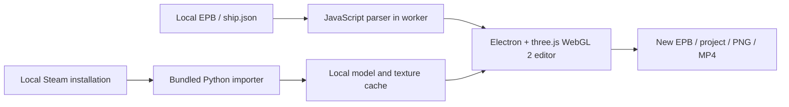

# Architecture, privacy and verification / Архитектура и проверка

## Architecture

Electron 45.3.3 supplies Chromium and Node.js. The UI uses three.js r170. A loopback HTTP server binds to 127.0.0.1; it is not intended as a LAN or internet service. Python 3.13 and UnityPy import original resources locally. EPB parsing runs in JavaScript; large project parsing uses a disposable worker. Source code remains private; shipped JavaScript/Python is readable runtime code, not a secure place for secrets. Parsers have not been separately open-sourced.

Renderer Node integration is disabled, context isolation and the Chromium sandbox are enabled. The preload bridge exposes a single import-memory cleanup operation. Same-origin checks protect mutating local endpoints. These measures reduce attack surface; they do not constitute an independent security certification. Treat third-party blueprints as untrusted files.

## Data and network

Regular editing/import uses local game files and downloaded Steam subscriptions. The editor does not implement analytics or automatic project uploads. Opening external help/Steam/GitHub links uses the browser. Optional AI generation invokes a detected, signed-in Codex or Claude Code CLI only when requested; that provider receives the prompt and build catalog under its own policies. A ChatGPT/Claude desktop window alone is not the CLI integration. No author API keys are bundled. User projects and imported resources remain outside the installation folder in the app data directory.

## Verify a release

1. Download the ZIP, SHA256SUMS.txt and SECURITY-REPORT.md from the same GitHub release.
2. Run `Get-FileHash .\EGS-BBS-0.7.0-beta.1-windows-x64.zip -Algorithm SHA256` in PowerShell and compare the complete hash.
3. Follow the exact-file VirusTotal link in the report. Check the analysis date and file hash. An absent report is not a scan result; 0 detections is not proof of safety.
4. The EXE is unsigned. Do not disable system protections. Report unexpected behavior through GitHub Issues, omitting personal paths, saves and secrets.

SHA-256 checks integrity against the published value, not publisher identity if both download and checksum are compromised. VirusTotal public submission shares files with its analysis ecosystem: only the public release archive should be submitted, never private source repositories or personal blueprints. See [VirusTotal documentation](https://docs.virustotal.com/docs/how-it-works).

## По-русски

Приложение — Electron с Chromium/Node.js, three.js и локальным Python-импортёром; не Tauri. Сервер слушает только 127.0.0.1. Разбор EPB и проектов выполняется локально. Исходный репозиторий закрыт, но поставляемые JS/Python читаемы. Отдельный открытый модуль парсеров пока не опубликован.

В интерфейсе отключён Node integration, включены sandbox и context isolation; изменяющие запросы проверяют origin. Это меры защиты, не независимый аудит. Обычная работа не отправляет корабли и не содержит аналитики. Опциональный запуск Codex/Claude Code отправляет промпт и каталог выбранному провайдеру. Ссылки Steam/GitHub открываются внешним браузером.

Для проверки сравните SHA-256 архива с файлом выпуска, затем дату и хэш отчёта VirusTotal. EXE не подписан. Отсутствие детектов не гарантирует безопасность, а совпадение хэша не заменяет подпись автора. В VirusTotal отправляется только публичная сборка, не закрытый репозиторий и не личные файлы. Не отключайте защиту Windows.
